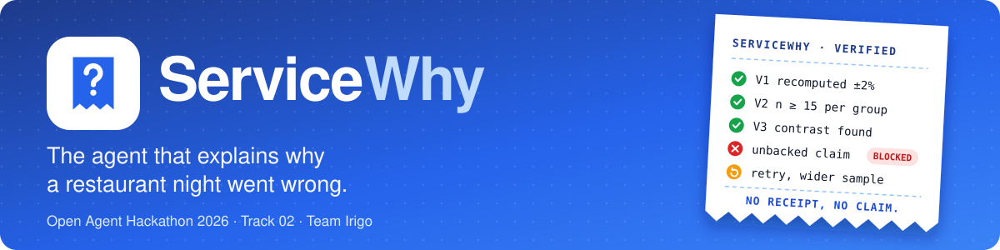
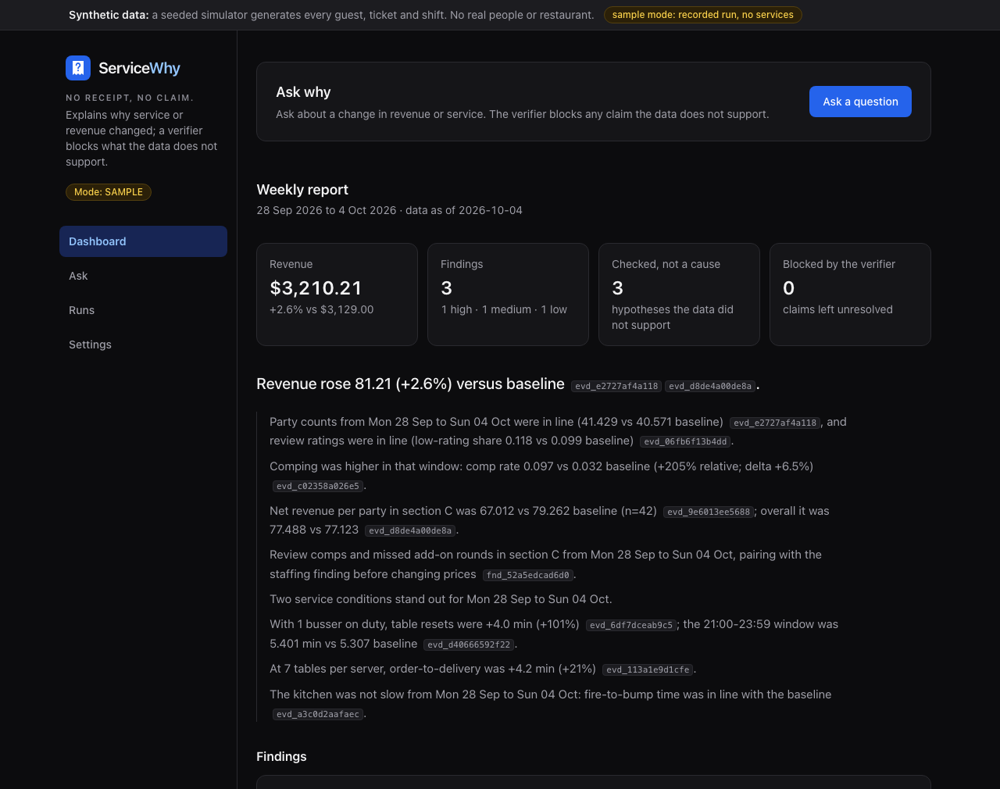
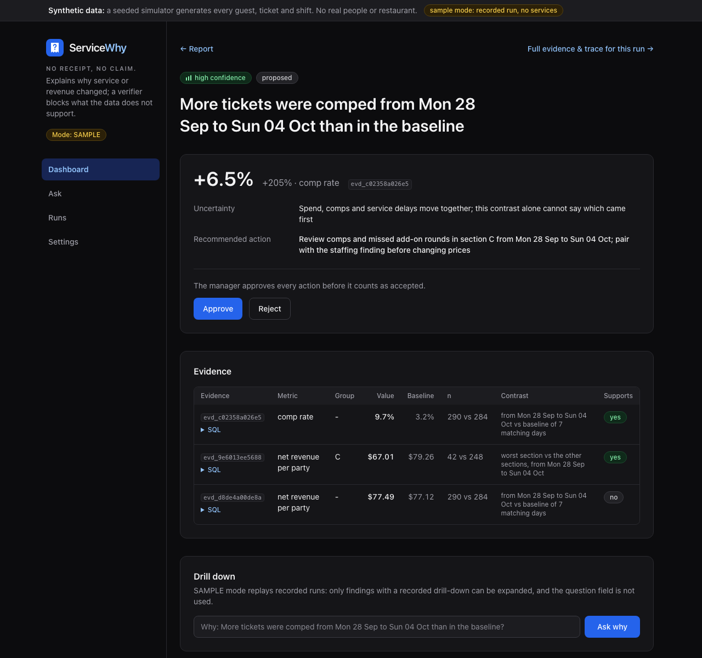
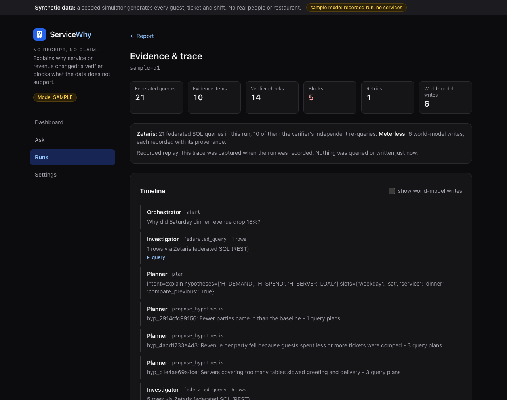
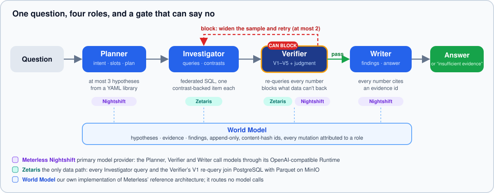

<p align="center">
  
</p>

<p align="center">
  <a href="#run-it"></a>
  
  
  
  
  
  <a href="LICENSE"></a>
</p>

<p align="center">
  <b>Open Agent Hackathon 2026 · Track 02 (The Agent That Can Explain Why) · Team Irigo</b><br>
  <a href="https://youtu.be/1Qmu-7wi4Uk">Demo video</a> ·
  <a href="docs/OAH2026-ServiceWhy-Deck.pdf">Pitch deck</a> ·
  <a href="#run-it">Run it</a> ·
  <a href="#how-it-works">How it works</a> ·
  <a href="#sponsor-technology">Sponsor technology</a> ·
  <a href="#ai-and-model-usage">AI and model usage</a> ·
  <a href="#scorecard">Scorecard</a> ·
  <a href="#api">API</a> ·
  <a href="#data-and-limitations">Limitations</a>
</p>

<p align="center">
  <a href="https://youtu.be/1Qmu-7wi4Uk"><b>▶ Watch the demo video (about 4 minutes)</b></a>: the problem, the four agents, a Verifier block and retry, a live run through Zetaris and Meterless Nightshift, and the scorecard. The narration is AI-generated text-to-speech.<br>
  <a href="docs/OAH2026-ServiceWhy-Deck.pdf"><b>Pitch deck (PDF)</b></a>
</p>

> [!IMPORTANT]
> **All data is synthetic.** A seeded discrete-event simulator generates every guest, ticket, shift and review. No real guest, staff or customer data is used anywhere, and every UI screen says so.

## What it does

A restaurant manager asks *"Why did Saturday dinner revenue drop 18%?"* and gets an evidence-backed answer built from point-of-sale tickets, table-service events, shift rosters and guest reviews. A **verifier re-queries every number, then blocks any claim its numbers, sample size or comparison do not support**. It retries on a wider sample, or answers "insufficient evidence".

| 🔎 Investigates | 🛡️ Verifies | 🧾 Explains |
|---|---|---|
| Plans up to 3 hypotheses and queries both data stores in one federated SQL statement through Zetaris | Recomputes every value independently and checks sample size and contrast. A claim that fails is blocked, retried on a wider sample, or answered with "insufficient evidence" | Every number in the answer cites an evidence id. Causes are staffing or process conditions, never named people, and the manager approves every action |

<table>
  <tr>
    <td width="33%" valign="top">
      <a href="docs/assets/ui-report.png"></a>
      <br><sub><b>Weekly report.</b> Revenue, findings ranked by confidence, and what the verifier blocked.</sub>
    </td>
    <td width="33%" valign="top">
      <a href="docs/assets/ui-finding.png"></a>
      <br><sub><b>One finding.</b> Effect size, uncertainty, the evidence table with its SQL, and approve or reject.</sub>
    </td>
    <td width="33%" valign="top">
      <a href="docs/assets/ui-trace.png"></a>
      <br><sub><b>Evidence and trace.</b> Every federated query, check, block and retry, in order.</sub>
    </td>
  </tr>
</table>

<sub>Screenshots are taken in SAMPLE mode (a recorded run, labelled as such on screen).</sub>

## Run it

There are two ways to run ServiceWhy. **A** needs nothing. **B** is one command once its prerequisites exist.

| | 🟢 **A · SAMPLE** | 🟣 **B · FULL** |
|---|---|---|
| **Needs** | Docker, or Python 3.11+ | Zetaris local bundle and Meterless Nightshift |
| **Keys** | none | the Nightshift Runtime token and the Zetaris values |
| **What runs** | recorded runs through the same API and UI | the real agent on Zetaris federated SQL and a live model |
| **Command** | `docker compose up --build` | `make full` |
| **Open** | UI `http://localhost:5173` · API `http://localhost:8000/docs` | same ports |

### A. SAMPLE: no keys, no services

> [!NOTE]
> **SAMPLE is a replay, not a live agent.** The API looks up the stored response for the normalised question text (`app/sample.py`), and every response says so (`mode.sample_mode`, `recorded_with`). The recordings come from a real FULL-mode run (Zetaris and a live model), and the traces show every plan, query, verdict, block and retry from that run. It makes no network calls, needs no keys and starts no Zetaris, Postgres or MinIO. To see the agent execute, use path B, or `make e2e` (the real orchestrator on a local seeded store, with the recorded model responses replayed). SAMPLE ignores any model key or Nightshift setting.

```bash
git clone https://github.com/KoangWy/servicewhy && cd servicewhy
docker compose up --build          # no .env needed: SAMPLE_MODE defaults to true
# UI   http://localhost:5173
# API  http://localhost:8000/docs
curl -X POST http://localhost:8000/run -H "Content-Type: application/json" -d @input_examples/example_1.json
```

Without Docker (Python 3.11+):

```bash
pip install -r requirements.txt
SAMPLE_MODE=true python run.py     # API on 0.0.0.0:8000
SAMPLE_MODE=true python run.py ask "Why did Saturday dinner revenue drop 18%?"
```

`GET /health` reports `{"zetaris": "sample", "sample_questions": [...]}`, which lists the questions that were recorded. A question that was not recorded returns a structured `SampleModeMiss` error, not a guess.

### B. FULL on the synthetic (mock) data

FULL mode runs the real agent: Zetaris federated SQL over the seeded stores and a live model through Meterless Nightshift. The data is still the synthetic simulator output. Three prerequisites, then one command.

1. **🟦 Zetaris local bundle running.** Download `zetaris-platform.zip` from Zetaris Cloud ("Run locally"), then run `docker login zetarishackathon.azurecr.io`, `./preflight.sh` and `docker compose up -d` inside it. The bundle images are amd64. On Apple Silicon they run emulated, so budget several minutes for startup. ServiceWhy reaches the bundle through its published ports: 3000 for login, 8888 for REST.
2. **🟪 Meterless Nightshift installed and running.** Download it from meterless.ai and enter your email at the access gate. In the Nightshift Console, copy the **Nightshift URL** and the **Runtime API key**. The model provider key (for example NVIDIA) is entered in Nightshift's **Providers** tab and never in this repo's `.env`; you choose any key and model inside Nightshift. Nightshift exposes an OpenAI-compatible Runtime (default `http://127.0.0.1:8088/v1`).
3. **📝 Fill `.env`.** `cp .env.example .env`, then set `METERLESS_RUNTIME_TOKEN` (the Runtime API key) and the Zetaris values (`ZETARIS_USER`, `ZETARIS_PASSWORD`, `ZETARIS_API_KEY`, `ZETARIS_ORG_ID`). Change `METERLESS_BASE_URL` only if the Console shows a different Nightshift URL. Pin `METERLESS_MODEL` to a concrete cloud model id (see the note on `meterless/auto` below).

```bash
make full        # runs scripts/up-full.sh
```

> [!TIP]
> `make full` checks, in order, that **`.env` is filled in**, **Docker is running**, **Zetaris answers** and **Nightshift answers with at least one model**. Each failure prints what is wrong and the exact fix. It then runs `docker compose --profile full up -d --build`, waits for `http://localhost:8000/health` (up to 180 s) and runs the idempotent seed job (`docker compose --profile full run --rm seed`: simulator → Postgres + Parquet on MinIO → Zetaris registration). `scripts/up-full.sh --check` runs the checks only and starts nothing.

Ask a question in the UI, or:

```bash
curl -X POST localhost:8000/run -H "Content-Type: application/json" \
  -d '{"input":{"query":"Why did Saturday dinner revenue drop 18%?"}}'
```

The trace is written to `logs/trace-<run_id>.jsonl` and to stdout. From a Python checkout, `make seed`, `make e2e-full` and `python run.py` do the same steps.

**Secondary provider: OpenCode Go.** To use OpenCode Go (OpenAI-compatible) instead of Nightshift, set `MODEL_PROVIDER=opencode` and `MODEL_API_KEY` in `.env` (`MODEL_BASE_URL` and `MODEL_ID` are in `.env.example`). Nothing falls back silently: with `MODEL_PROVIDER=meterless`, a Nightshift failure is reported as an error, not retried on OpenCode Go.

> [!WARNING]
> **Re-seeding trap.** The seed job registers the two stores in Zetaris once; when they already exist it does nothing ("already registered (no-op)"). If you change `MINIO_ROOT_PASSWORD` or the Postgres credentials after the first seed, Zetaris keeps the old ones and reads fail with `ZetarisError ... AccessDeniedException ... 403 Forbidden`. Restore the original values in `.env`, or remove the registered sources in Zetaris and seed again. During our check the only Zetaris sources present came from an earlier run on the same machine; a registration from scratch was exercised in that earlier run, not repeated.

<details>
<summary><b>Observed with Nightshift (2026-10-27)</b>: four things worth knowing before you pick a model</summary>

1. The Runtime listens on `127.0.0.1:8088` and `[::1]:8088` only.
2. With nothing else dialable, `meterless/auto` was answered by the small on-device model `webllm/Llama-3.2-1B-Instruct-q4f16_1-MLC` (it runs inside the Nightshift window). That model is too small for this agent, so set `METERLESS_MODEL` to a concrete cloud model id from `GET /v1/models`. Settings shows which model answered and warns when it is on-device.
3. An OpenCode Go key saved in Nightshift was rejected by OpenCode with `MissingSessionID`, because Nightshift does not forward the `x-opencode-session` header OpenCode Go requires. Use `MODEL_PROVIDER=opencode` (direct) for OpenCode Go, and a provider Nightshift serves (for example NVIDIA) for Nightshift.
4. Nightshift does not list `deepseek-v4.1-flash`, the model behind the first published scorecard.

</details>

<details>
<summary><b>Docker and Nightshift</b>: what was checked and what was not</summary>

The `api` container reaches Nightshift through `host.docker.internal` (`METERLESS_BASE_URL_FROM_DOCKER` in `docker-compose.yml`). **Checked** on 2026-10-27 on Docker Desktop for Mac (Apple M2 Pro): the container reached Nightshift's loopback-only Runtime (`/healthz` 200, `/v1/models` 401 without the token), and a clean clone with `make full` answered a real question through Zetaris federated SQL and Nightshift (Nemotron 3 Ultra): success in 79.8 s, 13 queries, 3 model calls, one verifier block and retry; `/health` reported `zetaris: up`.

**Not checked:** Docker on Linux, where `host.docker.internal` needs the `host-gateway` entry already in `docker-compose.yml` and where Nightshift's listening address is UNVERIFIED. If a container cannot reach Nightshift, run the API on the host instead: `SAMPLE_MODE=false python run.py`.

</details>

<details>
<summary><b>Settings screen</b>: change the model connection without editing <code>.env</code></summary>

The UI Settings page shows the current mode (`sample_mode`, `data_backend`, `model_mode`) and the current model connection (provider, URL, model id, and whether a token is set; the token itself is never returned). It lets you set the Nightshift URL, Runtime token and model id, and has a **Test connection** button.

- Changes live in the API process's memory only, apply to subsequent runs and are never written to disk.
- In SAMPLE mode the model cannot be changed, because SAMPLE replays recorded runs.
- Changing the URL requires entering the token again in the same request, so a stored token cannot be redirected to another host.
- Test connection lists the models from `GET {base}/models`, then sends one tiny chat completion, and reports what failed (unreachable, unauthorized, no models, model unavailable, timeout).

Endpoints: `GET /settings`, `PUT /settings/model`, `POST /settings/test` (see the [API](#api) table).

</details>

## How it works

<p align="center">
  
</p>

| Role | Job |
|---|---|
| 🧭 **Planner** | Turns the question into intent, time and segment slots, and at most 3 hypotheses from `app/agent/hypotheses.yaml`. Code enforces policy: a revenue question always carries the demand and spend hypotheses, and a request to rank individual staff is reframed into staffing conditions. |
| 🔎 **Investigator** | Runs query plans only through the data-access adapter (Zetaris federated SQL that joins PostgreSQL with the Parquet filestore). It computes contrasts: focus vs baseline, cross-section, dose-response across tables per server, bussers on duty, and time window. Each result is stored as a World Model evidence item. |
| 🛡️ **Verifier** | Applies the deterministic rules V1–V5 below, then one structured model judgment (`block`/`pass` plus a reason) that the claim matches what was measured: it blocks a claim whose metric or direction does not match, or that names a cause the data never recorded. The model never recomputes numbers. Confounders that remain are stated as the finding's uncertainty and left to the manager's approval. A block widens the sample to more of the same nights and retries. |
| ✍️ **Writer** | Writes findings in the fixed contract (cause, evidence, confidence, effect size, uncertainty, recommended action, status) and the answer. A number guard rejects any figure the evidence does not contain. |

Causes are always **staffing or process conditions** (section, shift, time window), never named people. The manager approves or rejects every recommended action (`POST /findings/{id}/approve|reject`), and each decision is logged with role and timestamp.

### The verifier (the differentiator)

| # | Rule | Threshold | Action |
|---|---|---|---|
| V1 | Every value recomputed by an independent second query through the same federated surface: raw rows aggregated in code, with revenue rebuilt from `ticket_items` | mismatch > ±2% | 🔴 block |
| V2 | Minimum sample per segment | n < 15 blocks; 15 ≤ n < 30 downgrades confidence | 🔴 block · 🟡 downgrade |
| V3 | A causal claim needs a contrast (baseline group present) | none found | 🔴 block |
| V4 | Decoy split: how much of a revenue change fewer parties explain vs revenue per party | volume share ≥ 50% | 🟡 downgrade service findings and force the split into the answer |
| V5 | Retry budget | > 2 rejections | ⚪ "insufficient evidence" |

Thresholds live in `app/agent/verifier.py` (`THRESHOLDS`). Runs are bounded: at most 3 hypotheses, 2 retries each, 12 investigate+verify steps per run, 60 s per model call and 40 model calls per run.

> [!WARNING]
> **The thresholds are initial values, tuned in one pass on real runs before the feature freeze (tuning pass and scorecard run: 2026-10-27 UTC).** The same pass covers the verifier's model-judgment prompt (`SYSTEM` in `app/agent/verifier.py`) and the hypothesis library's claim and cause wording (`app/agent/hypotheses.yaml`). The freeze is the commit that publishes the scorecard below (`29cdff1`, 2026-10-27 UTC): from it on, the thresholds, those prompts and the simulator parameters do not change (UI-only changes may follow). The pass worked from recorded verifier prompts and evidence payloads plus synthetic negative controls, and simulator ground truth was never an input to it. The pass was also checked against the scorecard questions: three live scorecard runs took the baseline from 2/10 to 8/10. **The published 8/10 is therefore an in-sample number** (same seed, same ten questions), not a held-out test.

## Sponsor technology

| Sponsor | Role in ServiceWhy | Proof you can open |
|---|---|---|
| 🟦 **Zetaris** <sub>(required)</sub> | The single federated SQL surface. Remove it and the agent cannot read its data | `logs/nightshift-example/trace-ui-vfy00002.jsonl`: every `query` event reads `Zetaris federated SQL (REST)` and carries the SQL and the row count · `tests/test_zetaris_adapter.py`, `tests/test_init_zetaris.py` (fake transport, keyless) |
| 🟪 **Meterless Nightshift** <sub>(required, primary model provider)</sub> | Every model call of the Planner, Verifier and Writer goes to the Nightshift Runtime | the `run_end` event in the same trace lists each request with `requested_model` and `routed_model` · `tests/test_meterless_provider.py` (18 tests against the stub in `tests/nightshift_stub.py`) |
| 🔷 **Meterless engine: World Model** <sub>(required, one engine in a feature)</sub> | Shared hypothesis, evidence and finding state with provenance; the Verifier reads its context builder | `tests/test_worldmodel.py` (7 tests) · `logs/nightshift-example/worldmodel-ui-vfy00002.jsonl` (every mutation, content-hash ids) |
| 🟩 **NVIDIA** <sub>(optional, award only)</sub> | Nemotron served through Nightshift; no key or SDK in this repository | all three model requests in the evidence run were answered by `nvidia/nemotron-3-ultra-550b-a55b`. No NVIDIA award claim is made |
| ⬜ **Cursor** <sub>(optional since 2026-10-23)</sub> | Not used as the development environment | see below |

- **Zetaris** is the single federated SQL surface. POS tickets, ticket items and table events live in PostgreSQL. Rosters, plate returns and reviews live as Parquet on MinIO. Both are registered by `scripts/init_zetaris.py` (CREATE DATASOURCE, REGISTER DATASOURCE TABLE, CREATE LIGHTNING DATABASE, CREATE LIGHTNING FILESTORE TABLE). Every Investigator query joins the two stores in one statement (`app/metrics.py`). The Verifier's independent V1 re-query goes through Zetaris again.
- **Meterless World Model.** Meterless provides the World Model agent engine, implemented in-repo after the Meterless reference architecture (`app/worldmodel/`). `WorldStoreService` is an append-only, replayable store with content-hash ids. `IngestPipelineService` gives idempotent, resumable writes with provenance. `ContextBuilderService` builds the structured payload the Verifier reads (`app/agent/verifier.py`); the Writer reads hypotheses and evidence through the ingest pipeline and does not use the context builder. Meterless' engines are reference architectures, so this is **our own implementation** of the World Model minimum (the three services above), not a Meterless-hosted service, and the World Model services route no model calls. Every mutation is a `wm_mutation` trace event and a line in `logs/worldmodel-<run_id>.jsonl`.
- **Meterless Nightshift is the primary model provider** (`MODEL_PROVIDER=meterless`, implemented in `app/adapters/model.py`): the model calls of the Planner, Verifier and Writer go to the Nightshift Runtime (an OpenAI-compatible endpoint) with the user's own provider key held inside Nightshift. What was checked:
  - **Real Nightshift** (M1-M4 edition 0.92.7, Apple M2 Pro, 2026-10-27): the Runtime token authenticates, `GET /v1/models` and `POST /v1/chat/completions` answer, and the Settings test reports the model that answered.
  - **FULL path, committed evidence** (`logs/nightshift-example/`): a clean clone with `make full` on Zetaris and Nightshift answered a question outside the recorded list in 79.83 s: 13 federated queries, 3 model calls (planner, verifier, writer), all answered by `nvidia/nemotron-3-ultra-550b-a55b`, one verifier block and one retry.
  - **Earlier run on the local store** (`DATA_BACKEND=local`, no Zetaris; its trace is not committed): 5 model calls, 2 verifier blocks, 1 retry, 2 findings, 131 s, and the answer's −39% revenue change split (17% fewer parties, 83% lower spend per party) matches the data.
  - **Not claimed:** the published 8/10 scorecard for any Nightshift-served model on Zetaris (see [Scorecard](#scorecard)).
- **Cursor** was almost not used. Development was done with Claude as the coding assistant (50 of the 59 commits on `main` at `57a1e5d` carry a `Co-Authored-By: Claude` trailer). The repository carries the project rules in `.cursor/rules/`, but the team never received Cursor sponsor credit and did not use Cursor as its development environment. The event's 2026-10-23 announcement and Official Rules section 8.1 make Cursor optional (any AI coding tool is allowed); we state what was used regardless.
- **NVIDIA**: no NVIDIA SDK or key is in this repository. Nemotron models can be served through Nightshift (the verified run above used `nvidia/nemotron-3-ultra-550b-a55b`); the NVIDIA key stays in Nightshift's Providers tab and this repository never handles it.

## AI and model usage

| # | Disclosure | ServiceWhy |
|---|---|---|
| 1 | **Models used through Nightshift, and what each does** | Whatever the user configures in Meterless Nightshift (the default routing id is `meterless/auto`, a routing mode and not a model id). The verified run pinned `nvidia/nemotron-3-ultra-550b-a55b`. It does the Planner's hypothesis selection, the Verifier's one structured pass/block judgment and the Writer's prose. The model never writes SQL, never recomputes a number and never sees ground truth. |
| 2 | **Agent framework** | None. The Planner, Investigator, Verifier and Writer and their orchestrator are written in this repository (`app/agent/`, `app/orchestrator.py`). The World Model services (`app/worldmodel/`) are implemented from Meterless' World Model reference architecture. |
| 3 | **Zetaris, Meterless engine, Nightshift, NVIDIA** | See [Sponsor technology](#sponsor-technology). |
| 4 | **AI coding tool actually used** | Claude as the coding assistant, against specifications the team wrote (`docs/SPEC.md`, `docs/IMPL_SPEC.md`), checked with the team's own test and QA runs. Cursor was almost not used. |
| 5 | **External tools and libraries** | `requirements.txt` (FastAPI, Uvicorn, PyYAML, plus pyarrow, psycopg and minio for the loader only) and `ui/package.json` (React, Vite, Tailwind CSS). Zetaris runs as its own local Docker bundle. |
| 6 | **Data sources** | Entirely synthetic, generated by the seeded simulator in `app/sim/`. No real people, venue or customer data. |
| 7 | **Open-source code or templates materially adapted** | None. No third-party code or template was copied into this repository; libraries are used as dependencies, and the World Model is written from Meterless' reference architecture description. |
| 8 | **Known limitations** | See [Data and limitations](#data-and-limitations) and the two scorecard misses below. |
| 9 | **Fallback or sample-mode behaviour** | `SAMPLE_MODE=true` replays recorded runs (see [Run it](#a-sample-no-keys-no-services)). Recorded model responses are committed as cassettes in `cassettes/`. With OpenCode Go as the provider, an optional backup provider (DeepInfra, also OpenAI-compatible) takes over after repeated transport errors when `MODEL_BACKUP_API_KEY` is set. Nightshift never falls back silently. |

**Colab:** no agent runs in Colab and the repository has no notebooks.

**Which model produced which number.** The secondary provider is OpenCode Go (`MODEL_PROVIDER=opencode`, an OpenAI-compatible endpoint, `MODEL_BASE_URL`). **The first published 8/10 scorecard was measured with `deepseek-v4.1-flash` through OpenCode Go.** The Verifier's prompt was tuned on that model, so another model, including one routed by `meterless/auto`, can score differently.

## Scorecard

`make scorecard` runs the ten canned questions in `app/scorecard/questions.yaml` on a fresh seeded dataset. It joins each trace and World Model log with the simulator's ground truth and prints the table published below. The agent never reads ground truth: only the harness loads it, and a default-suite test greps agent-side modules for any reference. It needs the FULL stack (Zetaris, a configured model and the seeded stores), so it cannot run in SAMPLE mode. The metrics are root-cause hit rate, evidence precision, unsupported claims caught vs wrongly blocked, decoy rejection, abstention correctness and retries per investigation.

**Published scorecard** (one FULL-mode run: 2026-10-27, seed 20261024, Zetaris federated SQL, `deepseek-v4.1-flash` through OpenCode Go). This is the run on the code committed as `939816b`. Later commits changed the Writer's wording and number guard, the hypothesis library's cause wording, and the cassette tooling. They did not change the verifier rules, thresholds or prompt. Grading the ten recorded runs in the committed sample bundle with the same harness gave 8/10 with the same two misses.

| Metric | Result |
|---|---|
| Root-cause hit rate (top finding names the injected condition and cites its window) | 🟡 2/3 (67%) |
| Evidence precision (cited items that support their claim) | 🟡 17/24 (71%) |
| Verifier: unsupported claims caught / wrongly blocked | 🟢 13 / 0 |
| Decoy rejection rate | 🟢 1/1 (100%) |
| Abstention correctness | 🟢 2/2 (100%) |
| Retries per investigation | 0.3 |
| Questions passing every check | 🟢 **8/10 (80%)** |

Two questions miss, and we did not change the product to hide them:

- 🔴 **Q1 (demo question): the root cause is ranked second.** The answer names the injected section-B condition, but as its second finding. Findings rank by confidence, the staffing finding rests on a small sample (`low`), and the spend finding, which is a symptom of the same night, comes first. Reordering causes above symptoms would satisfy the grader, but we decided it would be tuning to the answer key.
- 🔴 **Q6 (this week vs last week): no revenue split.** The seeded data holds no week-over-week revenue drop to split, which is what the grader's expectation assumes, and a retry widens "this week vs last week" to two weeks, so the answer covers a different period than the one asked.

The question's "18%" is a manager's guess. The verifier recomputes the change from the data: -39% for Saturday 3 Oct against its baseline (of which fewer parties explain 17%). The agent reports the measured figure and does not adopt the premise.

**Second measurement, through Nightshift** (2026-10-27, same seed, same ten questions, code at `5663658`, the later commits only add logging and URL handling; model `nvidia/nemotron-3-ultra-550b-a55b` served by Meterless Nightshift; data from the keyless SQLite stand-in for Zetaris because no Zetaris bundle ran on that machine, so **this is not a FULL-mode number**). Nothing was tuned for it. Result: **8/10 questions pass every check**, with the same two misses (Q1 ranking, Q6 split); root-cause hit 2/3, evidence precision 18/27 (67%), unsupported claims caught 11 and wrongly blocked 0, decoy rejection 1/1, abstention 2/2, 0.2 retries per investigation. It is in-sample for the same reason as the first table. We did not run this scorecard through Zetaris and Nightshift together.

Simulator parameters, verifier thresholds and the tuned prompts are frozen from the commit that publishes the first table.

## API

The UI and judges use the same endpoints.

| Method & path | Purpose |
|---|---|
| `POST /run` | One investigation. Request `{"run_id"?, "input": {"query", "context"?}, "options": {"sample_mode"}}`. Response `{run_id, status, output, agents[], trace_id, log_file, execution_time_seconds}`, or a structured `error` |
| `GET /runs` | The runs this process knows: `[{run_id, question, status}]` |
| `POST /reports`, `GET /reports`, `GET /reports/{id}` | Weekly report: summary, 3–5 findings, revenue split and a provenance appendix (a batch run of the same core); the list returns `[{report_id, period, status}]` |
| `GET /findings/{id}` | One finding (contract above) |
| `POST /findings/{id}/drilldown` | Nested investigation on one finding |
| `POST /findings/{id}/approve` · `/reject` | Manager decision, appended to `logs/approvals.jsonl` |
| `GET /traces/{run_id}` | The run trace (`?format=jsonl` returns the raw file) |
| `GET /health` | `{status, zetaris: up\|down\|sample\|local, model, sample_mode}` |
| `GET /activity` | What the agent is doing right now (in-memory and bounded); the UI's live status panel reads it in FULL mode |
| `GET /settings` | `{mode: {sample_mode, data_backend, model_mode}, model: {provider, base_url, model_id, token_set, source}, providers[]}`. The token is never returned. `providers` lists Meterless Nightshift (primary) and OpenCode Go with their default URL and model id |
| `PUT /settings/model` | Body `{provider, base_url?, model_id?, token?}`. Stored in process memory only and applied to subsequent runs; returns the `GET /settings` payload. A new `base_url` needs `token` in the same request (else 422 `TokenRequiredForNewBaseUrl`). In SAMPLE mode: 409 `SampleModeNoModel` |
| `POST /settings/test` | Same optional body, a one-off override that is not saved. Always HTTP 200 with `{ok, provider, base_url, latency_ms, models[], selected_model, selected_model_available, error}`; `error.type` is one of `Unreachable`, `Unauthorized`, `NoModels`, `ModelUnavailable`, `ChatFailed`, `Timeout`, `NotConfigured`, `SampleMode`. Timeouts are at most 10 s |

### Sample inputs and outputs

There are three input/output pairs in `input_examples/` and `output_examples/`:

| # | Pair | What it shows |
|---|---|---|
| 1 | `example_1.json` | The demo question, with findings and a revenue split |
| 2 | `example_2.json` | A non-cause probe: "No, the kitchen was not slow" |
| 3 | `example_3.json` | An abstention: "the data does not record menu changes" |

## Logs

Each run writes `logs/trace-<run_id>.jsonl` (schema version 1). The event set is `run_start, plan, query, evidence, verify, block, retry, answer, run_end, wm_mutation`. Each event carries the role, action, summaries, SQL, rows used, verdict and retry count. Readable lines also go to stdout. Secrets are masked (`…redacted`).

| Where | What |
|---|---|
| `logs/nightshift-example/` | One **live** run through Zetaris and Meterless Nightshift: the trace and the World Model log, with the model named for every request in the `run_end` event |
| `logs/examples/` | The SAMPLE bundle: recorded FULL-mode runs, replayed by SAMPLE mode (its `recorded_with` field says so) |

## Development

Keyless: no keys and no services needed.

```bash
pip install -r requirements-dev.txt
python -m pytest -q                 # 146 tests; local seeded store + offline fake model, no keys, no services
python scripts/e2e.py               # make e2e: demo question through POST /run on the local store, replaying the recorded model; asserts every role is in the trace
cd ui && npm ci && npm test && npm run dev   # 72 UI tests; UI on :5173, proxies /api to :8000
```

| Variable | Values |
|---|---|
| `SAMPLE_MODE` | `true`: replay the bundle in `logs/examples/` |
| `DATA_BACKEND` | `zetaris` (judged path) · `local`: the seeded simulator in SQLite (tests and keyless dev only) |
| `MODEL_PROVIDER` | `meterless` (default, Nightshift: `METERLESS_BASE_URL`, `METERLESS_RUNTIME_TOKEN`, `METERLESS_MODEL`, `METERLESS_APP`) · `opencode` (`MODEL_API_KEY`, `MODEL_BASE_URL`, `MODEL_ID`) |
| `MODEL_MODE` | `live` · `record`: QA machine writes `cassettes/` with secrets masked · `record-missing`: replay a cassette when one exists, record it when not · `replay`: a cassette miss fails loudly · `fake`: offline rules (tests only) |

The sample bundle in `logs/examples/` and the three example pairs were recorded from a FULL-mode run (Zetaris, `deepseek-v4.1-flash`). The model responses behind it are committed as cassettes in `cassettes/`, and replaying them against Zetaris (`DATA_BACKEND=zetaris MODEL_MODE=replay python scripts/seed_sample.py --out <tmpdir>`) reproduces the same answers without model calls. `make e2e` replays a second cassette set recorded on the local store (`make record-e2e`), because evidence ids depend on the data backend; see `cassettes/README.md`. A model call is not perfectly repeatable, so a re-recorded bundle can differ in wording or in which hypotheses the planner picks.

## Clean-machine checklist

SAMPLE mode, zero credentials:

- [ ] `git clone` the repo, `cd servicewhy`, then `docker compose up --build`.
- [ ] `curl localhost:8000/health` returns `"zetaris": "sample"`.
- [ ] `curl -X POST localhost:8000/run -H "Content-Type: application/json" -d @input_examples/example_1.json` returns `status: success`, findings and a revenue split.
- [ ] `curl localhost:8000/traces/sample-q1` shows planner, investigator and verifier events, including a `block` and a `retry`.
- [ ] `http://localhost:5173` shows the report, a finding with approve/reject, and the trace panel. The synthetic-data label is on every screen.
- [ ] `docker compose logs api` shows the replayed trace lines.

## Data and limitations

- The data is synthetic: 1 venue, 20 tables in 4 sections, 5 weeks, lunch and dinner. The injected incidents are I1 (section B runs 7 tables per server, Fri/Sat 19:00–21:00 from 21 Sep) and I4 (one busser after 20:00, Thu–Sat, from 21 Sep), plus the D2 decoy (fewer walk-ins on the last Saturday). Incidents are configured only in `app/sim/incidents.py`.
- Single-night segments are small (about 30 dinner parties), so the verifier often widens the sample before it will pass a claim. That behaviour is intended.
- There is no weather or events feed. The demand-side explanation is inferred from fewer parties, not observed.
- The published scorecards are in-sample, and the first one is not claimed for any Nightshift-served model (see [Scorecard](#scorecard)).
- Docker on Linux is untested for reaching Nightshift from a container (see [Docker and Nightshift](#b-full-on-the-synthetic-mock-data)).
- A real deployment would need consent and data-protection review (for example Vietnam's Decree 13/2023 on personal data). ServiceWhy deliberately works on shifts and sections, not individuals, and uses no faces or audio.

## Repository layout

```text
app/agent/        planner, investigator, verifier, writer, hypotheses.yaml, scope (periods)
app/worldmodel/   Meterless World Model: store, ingest pipeline, context builder
app/adapters/     Zetaris data-access adapter, model adapter (live/record/replay/fake)
app/metrics.py    the one metric catalog (SQL per dialect)
app/sim/          simulator, incidents, loader, local keyless store
app/api/ app/report/ app/scorecard/ app/logging/
ui/               Vite + React + TypeScript (report, finding, evidence & trace, drill-down)
scripts/          up-full.sh (make full), init_zetaris.py, seed_sample.py, e2e.py, meterless_gate.py
docs/assets/      README banner, pipeline diagram and UI screenshots
```

## License

MIT, see [LICENSE](LICENSE).

<p align="center"><sub>Built by <b>Team Irigo</b>: Lê Quang Minh Khoa and Nguyễn Quang Huy · Open Agent Hackathon 2026</sub></p>
